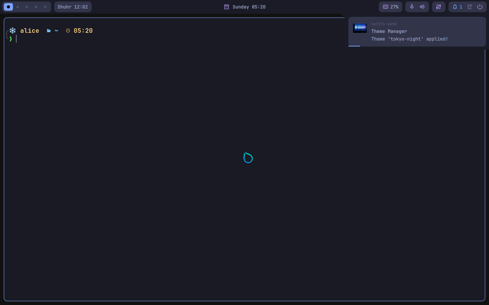

# hyprsimple-nix

[](https://github.com/mysh264/hyprsimple-nix/actions/workflows/ci.yml)

[hyprsimple](https://github.com/rizukirr/hyprsimple), the minimal Hyprland
desktop by [rizukirr](https://github.com/rizukirr), on NixOS.


hyprsimple is made for Arch Linux: its `install.sh` installs 84 packages with
pacman and the AUR, enables services with `sudo systemctl`, and
copies its configs into your home directory. None of that works on NixOS, and
copying the dotfiles by hand leaves you with scripts that point at `/bin/bash`,
`/usr/lib` and `pacman`.

This flake does it properly:

- **A NixOS module** installs every package hyprsimple lists and turns on the
  services its installer enables, the NixOS way.
- **`hyprsimple-install`** does the per-user part of `install.sh`: configs,
  helper scripts, user services, the default theme and the shell integration.
- **`hyprsimple-update`** keeps working. After a NixOS upgrade brings a new
  hyprsimple, it delivers it, runs hyprsimple's migrations and tells you which
  of your configs changed, the same as on Arch.
- **The pieces nixpkgs lacks** are packaged here: `hyprqt6engine` (the Qt
  theme hyprsimple selects) and `muslimtify` (the prayer times hyprsimple
  installs by default).

Everything you get is hyprsimple's own: the same bar, themes, keybindings and
scripts, patched only where NixOS needs it.

> This is an unofficial port, not affiliated with hyprsimple. Report problems
> with the NixOS side [here](https://github.com/mysh264/hyprsimple-nix/issues),
> and problems with hyprsimple itself
> [upstream](https://github.com/rizukirr/hyprsimple/issues).

## Requirements

- NixOS 26.05 or nixos-unstable. hyprsimple's config is written in Lua, which
  needs Hyprland 0.55 or newer; both channels have it, and CI tests both.
- x86_64-linux. aarch64-linux evaluates and should build, but is not tested.

## Install

### 1. Add the module

With flakes, add the input and the module to your system flake:

```nix
{
  inputs = {
    nixpkgs.url = "github:NixOS/nixpkgs/nixos-unstable";
    hyprsimple-nix = {
      url = "github:mysh264/hyprsimple-nix";
      inputs.nixpkgs.follows = "nixpkgs";
    };
  };

  outputs = { nixpkgs, hyprsimple-nix, ... }: {
    nixosConfigurations.my-machine = nixpkgs.lib.nixosSystem {
      modules = [
        ./configuration.nix
        hyprsimple-nix.nixosModules.default
        { programs.hyprsimple.enable = true; }
      ];
    };
  };
}
```

<details>
<summary>Without flakes</summary>

```nix
# configuration.nix
{
  imports = [
    "${builtins.fetchTarball "https://github.com/mysh264/hyprsimple-nix/archive/main.tar.gz"}/modules/nixos.nix"
  ];
  programs.hyprsimple.enable = true;
}
```

Pin the tarball to a commit (and add its `sha256`) if you want rebuilds to be
reproducible.
</details>

<details>
<summary>Starting a new configuration</summary>

```sh
mkdir my-nixos && cd my-nixos
nix flake init -t github:mysh264/hyprsimple-nix
nixos-generate-config --show-hardware-config > hardware-configuration.nix
```

Then edit `configuration.nix`: the hostname, your user, and the boot loader.
</details>

### 2. Rebuild

```sh
sudo nixos-rebuild switch --flake .#my-machine
```

### 3. Set up your user

As the user who will use hyprsimple (not root), from a TTY or your current
desktop:

```sh
hyprsimple-install
```

It moves any config hyprsimple replaces to `<name>.backup` first, and lists
them before it does. Nothing is deleted.

### 4. Log in

Pick **Hyprland (UWSM)** on your login screen. Without a display manager, log
in on a TTY and run:

```sh
uwsm start hyprland-uwsm.desktop
```

The template's `configuration.nix` shows a minimal login screen with greetd
and tuigreet.

Then set up your displays in `~/.config/hypr/monitors.lua`. `SUPER + T`
opens a terminal, and `SUPER + /` lists every keybinding.

## Updating

hyprsimple-nix pins a hyprsimple release (now **0.4.5**) and follows
upstream's releases; a weekly job opens a pull request here when a new one is
tagged. To update:

```sh
nix flake update hyprsimple-nix
sudo nixos-rebuild switch --flake .#my-machine
hyprsimple-update        # as your user
```

On NixOS, `hyprsimple-update` takes hyprsimple from your system configuration
instead of git. Everything after that is upstream's update: it refreshes the
scripts in `~/.local/bin`, runs new migrations, re-renders themes whose
templates changed, lists the configs this update changed that you have your
own version of, restarts the bar when it changed, and reloads Hyprland. Like
upstream, it never edits your `~/.config` files except through a migration.

`hyprsimple-update --stable` and `hyprsimple-update <branch>` do not apply:
your NixOS configuration chooses the version.

<details>
<summary>Tracking main</summary>

Upstream recommends releases; `main` is its development branch. If you want it
anyway:

```nix
{ options, pkgs, ... }:
{
  programs.hyprsimple.package =
    options.programs.hyprsimple.package.default.overrideAttrs {
      version = "0.4.5-unstable-2026-11-01";
      src = pkgs.fetchFromGitHub {
        owner = "rizukirr";
        repo = "hyprsimple";
        rev = "<commit on main>";
        hash = ""; # build once; Nix prints the hash to put here
      };
    };
}
```

The NixOS patches are written against the pinned release. If one stops
applying, the build tells you which.
</details>

## Options

| Option | Default | |
|---|---|---|
| `programs.hyprsimple.enable` | `false` | Install hyprsimple and everything it needs. |
| `programs.hyprsimple.defaultTheme` | `"deep-sea"` | The theme `hyprsimple-install` applies first. Any of hyprsimple's 40 themes. |
| `programs.hyprsimple.excludePackages` | `[ ]` | Packages hyprsimple installs that you do not want, e.g. `[ pkgs.firefox ]`. |
| `programs.hyprsimple.muslimtify.enable` | `true` | Prayer times on the bar, which hyprsimple installs by default. |
| `programs.hyprsimple.localsend.openFirewall` | `true` | Open port 53317 for LocalSend, as hyprsimple's installer does. |
| `programs.hyprsimple.package` | pinned release | hyprsimple's files and the `hyprsimple-*` tools. |
| `programs.hyprsimple.muslimtify.package` | from this flake | |
| `programs.hyprsimple.qt.hyprqt6engine` | from this flake | Built against your system's Qt. |

### What the module turns on

The equivalent of what `install.sh` installs and enables on Arch. Services are
set with `mkDefault`, so your own setting wins:

- `programs.hyprland` with UWSM, Hyprland's portal plus the GTK one for file
  pickers, polkit, dconf, Qt plugin paths, webp support in GTK.
- A PAM service for hyprlock, without `programs.hyprlock`, which would also
  start a second hypridle next to the one hyprsimple starts.
- NetworkManager, Bluetooth, power-profiles-daemon (unless TLP is on), UPower,
  gvfs, udisks2, systemd-resolved, PipeWire with ALSA and Pulse.
- The firewall port for LocalSend. NixOS's firewall takes the place of ufw.
- `~/.local/bin` on `PATH`, where hyprsimple keeps its scripts.
- Every package and font in hyprsimple's `packages.txt` and
  `aur-packages.txt`. The mapping is in
  [`modules/arch-packages.nix`](modules/arch-packages.nix), and a check fails
  when upstream lists a package it does not cover.

### What stays yours

`install.sh` also looks at your hardware. On NixOS that belongs in your
configuration:

<details>
<summary>NVIDIA</summary>

```nix
hardware.graphics.enable = true;
services.xserver.videoDrivers = [ "nvidia" ];
hardware.nvidia = {
  modesetting.enable = true;
  open = true; # Turing (GTX 16xx, RTX 20xx) and newer; false for older cards
};
```

When the NVIDIA card is the only GPU, hyprsimple's installer adds these to
`~/.config/uwsm/env`; add them yourself:

```sh
export NVD_BACKEND=direct           # Maxwell, Pascal, Volta: egl
export LIBVA_DRIVER_NAME=nvidia     # Turing and newer only
export __GLX_VENDOR_LIBRARY_NAME=nvidia
```

With an integrated GPU as well, leave those out and use PRIME offload
(`hardware.nvidia.prime.offload`), as hyprsimple does.
</details>

<details>
<summary>Intel laptops</summary>

```nix
services.thermald.enable = true;
hardware.graphics.extraPackages = [ pkgs.intel-media-driver ];
```
</details>

## Good to know

- **Home Manager.** hyprsimple writes to its own files in `~/.config` (theme
  switching does, on every switch), so do not manage `~/.config/hypr`,
  `ghostty`, `uwsm` and the others with Home Manager. `hyprsimple-install`
  warns you if one of them is a link into `/nix/store`. If Home Manager owns
  your `.bashrc`, add `source ~/.local/bin/bashrc.sh` to it yourself.
- **Several users** on one machine each run `hyprsimple-install` once, and
  `hyprsimple-update` after an upgrade.
- **Plugins** work: `hyprsimple-plugin install OWNER/REPO`. If a plugin needs
  a package, it tells you which one to add to `environment.systemPackages`.
- **Diagnostics.** `hyprsimple-nixos status` shows the installed and provided
  versions, `hyprsimple-nixos check-packages` lists anything hyprsimple wants
  that NixOS does not provide, and `hyprsimple-debug` makes upstream's report
  with a NixOS section added.

## How it works

`pkgs/hyprsimple` is upstream's tree at the pinned tag with:

- `#!/bin/bash` → `#!/usr/bin/env bash`, and FHS paths (`/usr/lib/ladspa`,
  `/usr/share/icons`, the `PATH` in two user units) pointed at the NixOS
  profiles. Every substitution fails the build if upstream moves the line.
- Four small patches, each only taking effect when `/etc/hyprsimple/source`
  exists: `hyprsimple-update` delivers from the system configuration;
  `hyprsimple-plugin` checks plugin packages against it; `hyprsimple-migrate`
  puts a pacman stand-in on `PATH`, answering from your configuration, so
  Arch-minded migrations still get the right answer; `hyprsimple-debug`
  reports NixOS.

The module links the tree at `/etc/hyprsimple/source`. `hyprsimple-install`
and `hyprsimple-update` copy it to `~/.local/share/hyprsimple`, where every
hyprsimple script expects it, as ordinary writable files. That directory is a
local git repository with one commit per version NixOS delivered, which is how
upstream's update can still say what changed.

### Testing

```sh
nix flake check   # the VM test needs KVM
```

The VM test boots NixOS with the module, runs `hyprsimple-install` as a
normal user, checks that every command hyprsimple's scripts call is on
`PATH`, starts a Hyprland session through UWSM, and checks the bar, the
notification daemon, the session's user services, a theme switch at runtime, and a
`hyprsimple-update` to a changed version: the sync, a new migration going
through the pacman stand-in, the changed-config report, and an unmapped
package being reported. It saves screenshots, like this one after the switch
to Tokyo Night: hyprsimple's bar with the muslimtify plugin's next prayer, and
the theme notification showing the theme's webp wallpaper. (The VM has no GPU,
so hyprpaper cannot draw the wallpaper itself there.)



### Moving to a new hyprsimple release

A weekly workflow opens a pull request when upstream tags a release, with the
version and hash already bumped and the fast checks run. To finish one, or to
do it by hand:

1. Set `version` and `hash` in [`pkgs/hyprsimple/package.nix`](pkgs/hyprsimple/package.nix).
2. `nix build .#hyprsimple`. A patch or substitution that no longer applies
   fails here and names itself. Patches are plain `git diff` output against
   the tag; redo the change on a checkout of the new tag and regenerate it.
3. `nix build .#checks.x86_64-linux.package-mapping` lists packages upstream
   added; map them in [`modules/arch-packages.nix`](modules/arch-packages.nix).
4. Read the diff of upstream's `install.sh`. A new step that touches the home
   directory belongs in `cmd_install` in
   [`pkgs/hyprsimple/hyprsimple-nixos.sh`](pkgs/hyprsimple/hyprsimple-nixos.sh);
   a new system step belongs in the module.
5. Run the VM test.

## Credits

[hyprsimple](https://github.com/rizukirr/hyprsimple) is by rizukirr;
[hyprqt6engine](https://github.com/hyprwm/hyprqt6engine) is by Hypr
Development (BSD-3-Clause); [muslimtify](https://github.com/muslimtify-org/muslimtify)
is by muslimtify-org (MIT).

The Nix code, scripts and patches here are MIT licensed. hyprsimple itself has
no license file yet; this flake only fetches it from its GitHub repository,
the same way `git clone` does, and nothing here redistributes it.
