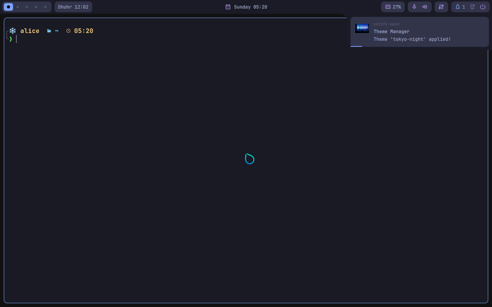

# How it works

For the curious, and for anyone who wants to help with hyprsimple-nix. You
do not need any of this to use hyprsimple.

## The problem

hyprsimple is made for Arch Linux. Its installer, `install.sh`, does three
kinds of things:

1. It installs 84 packages with `pacman` and the AUR.
2. It turns on system services, like Bluetooth, with `sudo systemctl`.
3. It copies its settings and scripts into your home folder.

On NixOS, parts 1 and 2 cannot work this way. NixOS builds the whole system
from your configuration, so packages and services must be *described* there,
not installed by hand. And hyprsimple's scripts expect things NixOS does not
have, like `/bin/bash` and `/usr/lib`.

## The answer, in three pieces

### 1. A NixOS module (`modules/nixos.nix`)

The module is what `programs.hyprsimple.enable = true;` turns on. It
describes parts 1 and 2 the NixOS way:

- every package from hyprsimple's lists. The list of which NixOS package
  stands for which Arch package is in
  [`modules/arch-packages.nix`](../modules/arch-packages.nix);
- the services `install.sh` enables: NetworkManager, Bluetooth, PipeWire,
  power-profiles-daemon, and so on;
- a few things Arch has by default and NixOS does not, like the GNOME
  settings schemas that hyprsimple's theme switcher writes to;
- what a desktop environment would bring on a NixOS that has none: the home
  folders (with `xdg-user-dirs`, at every login), previews of pictures and
  videos in the file manager, a fallback mouse cursor, and the accessibility
  bus;
- one change to NixOS's own Hyprland setup, on NixOS 26.05: it starts
  Hyprland through a "capability" wrapper, so that Hyprland can give itself
  realtime priority. A program started that way loses `TZDIR`, where NixOS
  keeps its time zones, and so does everything it starts: every program in
  the session then read named time zones as UTC
  ([nixpkgs#526193](https://github.com/NixOS/nixpkgs/issues/526193)).
  hyprsimple-nix turns the wrapper off, as nixos-unstable already did with
  Hyprland 0.57, and as on Arch, which never had it;
- the "Hyprsimple" login entry, when you ask for it
  (`programs.hyprsimple.loginEntry.enable`);
- extras hyprsimple does not have (yet), off until you turn them on:
  workspace names on the bar (`programs.hyprsimple.workspaces.names`), apps
  that open on their own workspace (`programs.hyprsimple.workspaces.apps`), keys
  for window groups (`programs.hyprsimple.groups.enable`), the i3 layout
  next to Hyprland's (`programs.hyprsimple.i3`, with the
  [hy3](https://github.com/outfoxxed/hy3) plugin, built for your Hyprland),
  keys for workspaces 11 and 12 and for the number pad
  (`programs.hyprsimple.keys`), the bar at the bottom
  (`programs.hyprsimple.bar.position`), a mended Viewnior
  (`programs.hyprsimple.viewnior.enable`, see below), and Viewnior's keys
  for swayimg and imv (`programs.hyprsimple.viewniorKeys.enable`: the files
  in [`modules/viewnior-keys`](../modules/viewnior-keys), written to
  `/etc/xdg/swayimg` and `/etc/imv_config`; swayimg 5 takes Lua, swayimg 4
  an INI file). The ones that change
  Hyprland are the Lua in [`modules/hyprland.lua`](../modules/hyprland.lua),
  written with your settings to `/etc/hyprsimple/hyprland.lua`, which
  hyprsimple's own config loads.

It also puts a few files in `/etc/hyprsimple`, for the tools below:

| File | What it is for |
|---|---|
| `/etc/hyprsimple/source` | the hyprsimple version this system provides |
| `/etc/hyprsimple/arch-packages` | the Arch package names this system provides |
| `/etc/hyprsimple/settings` | the module's settings, like the first theme |
| `/etc/hyprsimple/hyprland.lua` | what your settings add to Hyprland's configuration |
| `/etc/hyprsimple/shims/pacman` | a stand-in for `pacman`, explained below |
| `/etc/hyprsimple/shims/systemctl` | a stand-in for `systemctl`, explained below |

### 2. hyprsimple, prepared for NixOS (`pkgs/hyprsimple`)

This is hyprsimple itself, at a fixed release, with small changes so it fits
NixOS:

- Scripts start with `#!/usr/bin/env bash` instead of `#!/bin/bash`.
- Places like `/usr/lib/ladspa` and `/usr/share/icons` point to where NixOS
  keeps those things.
- Two user services had a hard-coded list of folders to look for programs
  in. On NixOS those folders are empty, so the list is replaced.
- Eleven small patches, in [`pkgs/hyprsimple/patches`](../pkgs/hyprsimple/patches).
  Numbers 1 to 4, 6 and 7 only do something when `/etc/hyprsimple` exists, so
  hyprsimple on Arch would behave exactly as before:
  1. `hyprsimple-update` takes the new version from your NixOS
     configuration, instead of downloading it with git.
  2. `hyprsimple-plugin` checks a plugin's packages against your NixOS
     configuration, instead of installing them with pacman.
  3. `hyprsimple-migrate` puts the stand-ins first in line. Migrations
     written for Arch ask pacman "is this installed?", and get a true answer
     from your NixOS configuration. And after a migration turns a service on
     with `systemctl --user enable`, the systemctl stand-in makes sure it
     still comes from your current system (see below).
  4. `hyprsimple-debug` reports NixOS facts in its debug report.
  5. `bashrc.sh` sets zoxide up after starship. This one fixes a bug that
     also happens on Arch.
  6. `hyprsimple-session.sh`, which adds the "Hyprsimple" login entry on
     Arch, says which NixOS setting does it. (The entry itself is the one
     that script writes: the package runs it once, at build time.)
  7. `hyprsimple.lua`, hyprsimple's own Hyprland config, also loads
     `/etc/hyprsimple/hyprland.lua`: after hyprsimple's defaults, before
     your own files, so your settings still win.
  8. The bar shows a workspace's name instead of its dot, when it has one,
     in a cell as wide as the name, and always shows workspaces that a rule
     names. It also asks Hyprland which workspaces have windows, as the
     bar's own list missed some. Without names, it is the bar as before.
  9. The theme templates give window groups, and the tabs of the i3
     layout, the theme's colours. Without them, nobody sees these colours.
  10. The bar can sit at the bottom: then its panels, notifications and
     tooltips open upwards out of it. At the top, nothing changes.
  11. The theme switcher makes Qt programs light or dark with the theme, as
     it does GTK programs. hyprsimple makes Kvantum the style of Qt
     programs, but gave Kvantum no theme, so they stayed light. Now they get
     Kvantum's Adwaita (KvGnome, or KvGnomeDark for a dark theme), the twin
     of the GTK theme. A Kvantum theme you chose yourself stays. This one
     fixes a bug that also happens on Arch.

Every change is checked when the package builds. If a new hyprsimple version
moves something, the build fails and says which change no longer fits,
instead of quietly shipping something broken.

### 3. The per-user tools (`hyprsimple-nixos`, `hyprsimple-install`)

- **`hyprsimple-install`** does part 3 of `install.sh`: it copies
  hyprsimple's files to `~/.local/share/hyprsimple`, copies the settings
  and scripts, turns on the user services, applies the first theme, and
  installs the default plugin.

  On NixOS, `systemctl --user enable` has a trap: for a service the system
  ships, like hyprpaper, it links that day's version from `/nix/store` into
  `~/.config/systemd/user`, and systemd keeps using it, through every update,
  until a garbage collection deletes it. Then the wallpaper, the password
  window and the night light are gone. So hyprsimple-nix points those links
  back at `/etc/systemd/user`, where the current system keeps its services:
  when it installs, at every `hyprsimple-update` (which also repairs installs
  from before), and after migrations.
- **`hyprsimple-nixos sync`** is what `hyprsimple-update` calls to bring in
  a new version.
- **`hyprsimple-nixos gpu`** looks at your graphics hardware, as
  `install.sh` does, and writes the NixOS settings for it.

`~/.local/share/hyprsimple` is a small git repository. Each version NixOS
delivers becomes one commit. That is how `hyprsimple-update` can still tell
you exactly which files a new version changed, just like on Arch, where it
compares git commits too.

## How we know nothing is missing

hyprsimple's README expects a fresh Arch install where "Hyprland" was picked
in the installer. Such a system has much more than hyprsimple's package
lists: Arch's base system, everything those packages pull in, and what the
installer adds. A NixOS without a desktop environment has none of that.

So we build that exact Arch system in a container, and compare it with what
hyprsimple-nix gives NixOS, one kind of thing at a time: commands, background
services, D-Bus services, autostart entries, file previews, portals, plugins,
fonts and icons. Every real gap found is closed in the module, and the
virtual machine test checks it. The scripts, and how to run them, are in
[`maintainers/arch-parity`](../maintainers/arch-parity).

The comparison also found two mistakes in hyprsimple itself, which happen on
Arch too: zoxide set up in the wrong order (it warned on the first `cd` of
every terminal), and terminal programs from the app menu (btop, yazi...)
not opening, because nothing told `uwsm` which terminal to use.
hyprsimple-nix fixes both.

## Packages nixpkgs does not have

- **[hyprqt6engine](https://github.com/hyprwm/hyprqt6engine):** makes Qt
  programs follow the theme. hyprsimple selects it. Built from its release
  plus one fix from its repository, so it builds against current Qt.
- **[muslimtify](https://github.com/muslimtify-org/muslimtify):** the prayer
  times, with two small patches. It sets itself up as a user service, and
  on NixOS a program's path changes with every update, so the first patch
  makes that service point at the stable path
  `/run/current-system/sw/bin/muslimtify`. The second fixes a muslimtify bug:
  it found a time zone in `/etc/zoneinfo` (where NixOS keeps them), but read
  its offset only from `/usr/share/zoneinfo`, so without `TZDIR` every zone
  was "UTC+0.0" and prayer times were hours off.
- **Viewnior, mended** (with `programs.hyprsimple.viewnior.enable`):
  nixpkgs' Viewnior, with two patches. Viewnior only read scrolling that
  comes in clicks, like a mouse wheel's. On Wayland, GTK passes a touchpad's
  scrolling on as smooth scrolling only, so two fingers neither zoomed nor
  turned photos there. The first patch reads smooth scrolling too, and
  turns it into the same steps: one per whole unit, as X11 counts a
  touchpad, and exactly one per click of a wheel. And dragging a zoomed-in
  photo, like the crop dialog's rectangle, drew straight onto the window,
  outside GTK's drawing: that shows on X11 only, so on Wayland the photo
  stood still. The second patch redraws both through GTK.
- **Quickshell**, which draws the bar, comes from NixOS but is wrapped in
  two ways: it can show webp pictures (most wallpapers are webp), and it
  keeps the name `qs`, which hyprsimple uses to find its bar.

## How it is tested

```sh
nix flake check   # the virtual machine test needs KVM
```

- **Packages** build, and muslimtify's own tests pass.
- **The package list** matches hyprsimple's lists exactly. If hyprsimple adds
  a package, this check fails until someone adds it to
  `modules/arch-packages.nix`.
- **Scripts** pass shellcheck, and every hyprsimple script still parses
  after the changes.
- **Whole systems** with the module, with the
  [template](../templates/default), and with every `gpu.nix` from
  [`tests/gpu`](../tests/gpu) evaluate without errors.
- **`hyprsimple-nixos gpu`** writes exactly the expected `gpu.nix` for 13
  example computers, and the [graphics guide](gpu.md) shows those files as
  the tool writes them.
- **A virtual machine** boots NixOS with the module, and, as a normal user:
  runs `hyprsimple-install`; checks that every command hyprsimple's scripts
  use is there; starts bash, zsh and fish without warnings; checks which
  programs open PDFs, videos and folders, and that pictures, webp files and
  videos get previews; checks that muslimtify gets time zones right, with
  and without `TZDIR`; checks that the user services come from the current
  system; starts Hyprland through UWSM; checks the bar,
  notifications, helper services, home folders, keyring and search, and
  that programs the session starts still know where the time zones are;
  opens a terminal program the way the app menu does; copies and pastes;
  takes a screenshot; switches the theme; moves the prayer time to the
  right with the settings guide's commands; turns on the extras with a
  rebuild; groups three terminals with the keys, takes one out and puts it
  back, and closes them one by one, the first one first, checking each time
  that only that one closed; in the i3 layout, checks that one window fills
  the screen, that a second makes tabs, that the tabs split and come back,
  and that SUPER + CTRL + SPACE switches a workspace, also through a reload;
  checks that an app opens on its own workspace; presses the keys for
  workspaces 11 and 12 and every number pad key; zooms in Viewnior with a
  pretend touchpad (and checks that a wheel click is one step); loads every
  example in the [keys guide](keys.md) and swipes with three fingers;
  moves the bar to the bottom and opens a panel and a notification there; runs `hyprsimple-update`
  with nothing new (repairing a service tied to `/nix/store` on the way) and
  then with a changed version; logs in again through the
  "Hyprsimple" login entry; and finally follows the
  [removal guide](uninstall.md) and checks that the old settings came back.

All of this runs on every change, on both NixOS 26.05 and nixos-unstable.

The virtual machine takes screenshots. This one is from right after the
theme switch: hyprsimple's bar with the next prayer time, and the theme's
notification showing its wallpaper. (The virtual machine has no graphics
card, so the wallpaper program itself cannot draw there.)



## Moving to a new hyprsimple release

A robot checks for new hyprsimple releases every week. When there is one, it
opens a pull request with the new version and the result of the quick
checks. To finish it, or to do it by hand:

1. Set `version` and `hash` in
   [`pkgs/hyprsimple/package.nix`](../pkgs/hyprsimple/package.nix).
2. Build it: `nix build .#hyprsimple`. If a change no longer fits, the build
   says which. The patches are plain `git diff` output: make the same change
   on a copy of the new release, and save the new diff.
3. Check the packages: `nix build .#checks.x86_64-linux.package-mapping`
   lists any new ones. Add them to `modules/arch-packages.nix`.
4. Read what changed in hyprsimple's `install.sh`. A new step that touches
   the home folder belongs in `cmd_install` in
   [`hyprsimple-nixos.sh`](../pkgs/hyprsimple/hyprsimple-nixos.sh). A new
   system step belongs in the module.
5. Run the virtual machine test: `nix build -L .#checks.x86_64-linux.vm`.

## Where things are

| Path | What it is |
|---|---|
| `flake.nix` | the entry point: module, packages, checks, template |
| `modules/nixos.nix` | the NixOS module |
| `modules/arch-packages.nix` | Arch package → NixOS package |
| `pkgs/hyprsimple/` | hyprsimple for NixOS, its patches, and the `hyprsimple-*` tools |
| `pkgs/hyprsimple/gpu/` | the pieces `hyprsimple-nixos gpu` builds `gpu.nix` from |
| `pkgs/hyprqt6engine/`, `pkgs/muslimtify/`, `pkgs/quickshell/`, `pkgs/viewnior/` | the extra packages |
| `templates/default/` | a starting configuration for new machines |
| `tests/` | all the checks above |
| `docs/` | these guides |
